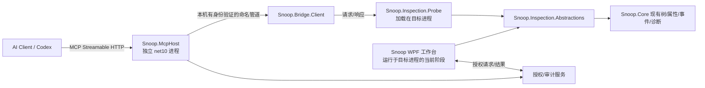

# Snoop Next — 工程架构与版本兼容性基准 v1.0

状态：工程设计基准（等待 Fork 中实际编译与进程附加验证）  
依据：`Snoop_Next_Interactive_Prototype_v1.1.html`、`Snoop_Next_Prototype_Acceptance_v1.1.md`  
上游：<https://github.com/snoopwpf/snoopwpf>（跟踪 `upstream/develop`）

## 1. 已确定、不得随意改变的约束

- 独立 GitHub Fork，自主发布；后续支持定期从上游 `develop` 合并/挑选补丁。
- 产品：VS 式工作台布局 + Fluent 视觉 + DevTools 属性检查体验，以 HTML v1.1 的**可观察交互**为验收依据。
- 最低目标 .NET Framework **4.6.2**，覆盖 .NET **6–11** 的 WPF 目标进程；Windows x86/x64，ARM64 根据上游已有能力和 Runner 验证。
- 以最新稳定 .NET 10/11 SDK 与 C# 工具链开发；禁止让共享代码依赖仅在新 CLR 可运行的语义。`PolyfillLib` 为常规 NuGet DLL 引用，不是「让旧 CLR 支持一切新 C# 特性」的保证。
- **RESX + 自定义轻量 WPF 动态绑定层**；语言和主题资源不得注入目标应用的全局 `Application.Resources`，也不全局修改其线程 Culture。
- MCP 必须由用户显式开启；默认只读，AI 附加目标需要人工确认，写入分单次/指定客户端 + 指定目标实例 + 指定工具的会话授权。
- 原型所有进程、控件和 AI 调用是模拟数据；正式产品不得复用模拟标识作真实句柄。

## 2. 渐进式总体架构



*该图是目标职责边界，不表示第一阶段就要修改上游的整套注入路径。* 先给既有功能包上 Inspection Facade，在 MCP 采用仅最小检查/桥接逻辑的探针。第一阶段工作台依然可以复用现有进程内 WPF UI；未来若需进程外 UI，另写 ADR 并替换数据访问适配层。

### 层与依赖方向

| 模块 | 运行位置 | 主要职责 | 不允许依赖 |
|---|---|---|---|
| `Snoop.Core`（上游原结构） | 目标进程 | WPF 元素、依赖属性、诊断与事件 | MCP SDK、ASP.NET Core |
| `Snoop.Next.UI`（可先作为 Snoop.Core 的新目录） | 目标进程 | Shell、停靠面板、属性编辑、状态展示 | HTTP 端点、MCP 身份认证 |
| `Snoop.Next.Localization` | UI 程序集 | RESX、CultureScope、`LocExtension` | 目标程序全局 Culture 更改 |
| `Snoop.Inspection.Abstractions` | 兼容程序集 | 语义数据模型、查询及修改接口、能力枚举 | WPF `Visual` 类型出现在 IPC DTO 中 |
| `Snoop.Inspection.Probe` | 目标进程 | 有边界的 WPF Dispatcher 调用、采样、句柄表 | Web 服务器、无限流日志 |
| `Snoop.Bridge.Contracts` | 两侧 | 有版本的 JSON 消息、DTO、错误码 | 任意 CLR 对象指针序列化 |
| `Snoop.McpHost` | 独立 .NET 10 进程 | HTTP MCP transport、客户端认证、审批、工具、审计 | 加载目标进程 WPF Visual |
| `Snoop.Next.Tests.*` | CI | net462/6/8/10/11 端到端兼容性 | 真实用户程序/管理员权限假设 |

`Snoop.McpHost` 推荐以 `net10.0` 运行（可单独编译 net11 变体）。这**不限制**它检查 net462 进程，因它通过 IPC 连接目标进程内的低版本探针。以新 SDK 构建，不等于在 net462 目标进程内运行 .NET 10。

## 3. 项目目录建议

```text
Snoop/                               # 尽量保留上游项目与路径
Snoop.Core/                          # 先不整体搬迁现有树/属性逻辑
  Next/UI/{Shell,Tree,Preview,Properties,Diagnostics,Mcp,Settings}/
  Next/Theming/{Tokens,Themes,Controls}/
Snoop.Next.Localization/             # 独立、无重型第三方 UI 框架依赖
Snoop.Inspection.Abstractions/       # WPF API 到基础 DTO 的分界
Snoop.Inspection.Probe/              # 目标进程线程调度/受限桥接
Snoop.Bridge.Contracts/             # wire format + errors + schema version
Snoop.McpHost/                       # 独立 Exe，MCP SDK + auth + audit
Tests/{Snoop.Next.UI.Tests,Localization.Tests,Bridge.Tests,Mcp.Tests,Compatibility.Harness}/
docs/{design,adr,mcp,acceptance}/
```

> **迁移策略**：最初的新 UI 文件可以创建在 `Snoop.Core/Next`，当跨模块边界实证稳定后再抽出项目。不要第一轮一次性移动上游 `SnoopUI.xaml`、`Styles.xaml` 和 Injector 的全部文件，避免 Git 合并冲突。

## 4. 目标框架矩阵

| 构建/运行场景 | 建议 TFM | 阶段与验证 |
|---|---|---|
| .NET Framework 4.6.2–4.8.1 WPF | `net462` | **P0 门禁**；在 .NET Framework 4.6.2 系统验证加载/绑定重定向/Polyfill DLL 闭包 |
| .NET 6/7/8/9 WPF | `net6.0-windows` 基线 + 各运行时 smoke | **P0 门禁**；每个运行时都要实测，不能只因兼容 TFM 就宣称注入成功 |
| .NET 10 WPF | `net10.0-windows` 优化目标 | 优先开发/验证，使用对应 BCL 能力 |
| .NET 11 WPF | `net11.0-windows` 优化目标 | SDK/Runner 可用时单独编译与验证，不承担低版本代码运行职责 |
| MCP Host | `net10.0`（可增加 `net11.0`） | **进程外**，不随被检查目标运行时改变 |
| Bridge.Contracts | `net462;net6.0;net10.0;net11.0` 或经实证的 `netstandard2.0` | 避免 WPF 特定引用；需锁定 JSON 序列化兼容性 |

多目标不是每个源码项目都必须包含全部中间 TFM；**产品支持矩阵是实际运行时兼容性测试，不仅是 csproj 能编译**。`PolyfillLib` 多目标编译且在旧框架中带额外依赖，依赖闭包、进程内程序集解析、冲突与 Win32 位数必须实测。

```xml
<!-- 示例：可迁移的新 UI 程序集，须在 Windows + 对应 SDK/Targeting Pack 验证 -->
<PropertyGroup>
  <TargetFrameworks>net462;net6.0-windows;net10.0-windows;net11.0-windows</TargetFrameworks>
  <UseWPF>true</UseWPF>
  <Nullable>enable</Nullable>
  <LangVersion>15.0</LangVersion>
</PropertyGroup>
<ItemGroup>
  <PackageReference Include="PolyfillLib" Version="x.y.z" />
</ItemGroup>
```

上面版本属性是**示意配置**，并非可直接 Restore 的文件；正式版本由中央包管理锁定，SDK/编译器版本需要在 P0 确认，并避免 `LangVersion=latest` 漂移。评估新语法应同时通过最低 TFM 编译与运行测试。

## 5. 运行时与进程边界约束

1. **最小侵入**：探针只在必要时访问 WPF Dispatcher，使用 `DispatcherPriority.Background` 或经测试的合适优先级；不阻塞目标 UI、禁用长耗时同步扫描。
2. **句柄不跨进程裸传递**：内部 WeakReference + 带版本的 opaque ElementHandle；每次附加有唯一 `attachmentId`（不能只看 PID/进程启动时间）。
3. **权限检查前后两次**：Host 接收 → 授权审查 → 执行前重新验证 `attachmentId`、客户端身份、目标进程实例与操作。Probe 同样校验版本/目标上下文。
4. **读取限流**：查询树提供根节点 + 分页/层级懒加载、最大节点和最大深度、超时与取消；异常/进程退出返回结构化错误。
5. **属性写入语义**：`GetValueSource` 与 BindingExpression 必须单独报告；写入默认不破坏原绑定，覆盖本地值必须明示；撤销只限可安全回退的修改，返回可撤销性。
6. **资源隔离**：主题字典以 Snoop Window/Control 的 ResourceDictionary 边界加载；不得添加进目标 Application.Resources；避免 Snoop 样式影响目标 UI。
7. **截图隔离**：进程内采集，经 IPC 传压缩图片/尺寸/DPI/高亮坐标，不在跨进程 WPF 之间共享 `VisualBrush` 或 `BitmapSource` CLR 对象。
8. **权限与注入失败**：权限不足时明确拒绝，不能通过假装提升权限、隐式管理员启动等方式绕过。

## 6. 持续从上游同步

```bash
git remote add upstream https://github.com/snoopwpf/snoopwpf.git
git fetch upstream
git switch develop
git merge upstream/develop    # 冲突先在独立集成分支处理，再 PR 到 develop
```

- `main`：发行；`develop`：集成；`feature/ui-*`, `feature/i18n-*`, `feature/mcp-*`。
- 先把 upstream 更新集成到 `chore/sync-upstream-YYYYMMDD`，运行兼容矩阵、UI 原型回归、授权安全测试，再 PR。
- 不自动覆盖 `main`。重点审查 `Snoop.Core/Windows/SnoopUI.xaml`、`Styles.xaml`、`ThemeManager.cs`、Injector/Launcher 项目。
- **保留上游版权、Ms-PL 许可证和第三方声明**；重命名和图标、产品标识需独立检查品牌/商标授权。

## 7. 架构验收门禁

- `P0`：原版 Fork 在 net462 与 net10 应用上真实成功附加；记录 baseline perf、项目依赖图及 PolyfillLib 最低框架加载。
- `P1`：独立 UI 窗口语言实时切换且目标应用 Culture/Resources/样式不变；现有 Snoop 检查功能仍正常。
- `P2`：HTML 每个功能 ID 在 WPF 有对应用户可观察状态，采用视觉差异审查。
- `P3`：独立 Host 能连接一个真实 legacy 探针和 modern 探针，读树不阻塞界面。
- `P4`：权限并发、断连、PID 重用/重新附加、重复执行、未知客户端等测试全部通过。
- `P5`：所有支持运行时/架构 smoke 和上游合并演练通过。

## 8. 参考

- Snoop `develop`：<https://github.com/snoopwpf/snoopwpf/blob/develop/Directory.build.props>
- Snoop `Snoop.Core.csproj`：<https://github.com/snoopwpf/snoopwpf/blob/develop/Snoop.Core/Snoop.Core.csproj>
- PolyfillLib：<https://github.com/SimonCropp/Polyfill/blob/main/polyfill-lib.md>
- PolyfillLib targets：<https://github.com/SimonCropp/Polyfill/blob/main/src/PolyfillLib/PolyfillLib.csproj>
- MCP official transports：<https://github.com/modelcontextprotocol/modelcontextprotocol/blob/main/docs/specification/2026-07-28/basic/transports/streamable-http.mdx>（正式实现以锁定的协议版本为准）